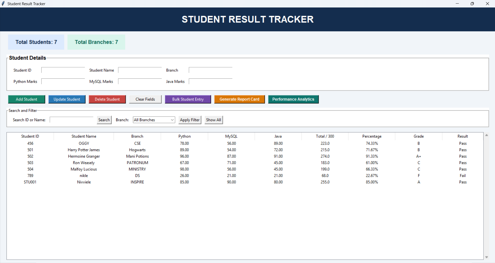

# Student Result Tracker



## Project Overview

Student Result Tracker is a desktop application developed using Python, Tkinter, and MySQL. It helps manage student academic records, calculate results, search student information, and analyze academic performance through a graphical user interface.

## Features

- **Student Management:** Add, update, search, and delete student records.
- **Result Calculation:** Automatically calculate total marks, percentage, grade, and pass/fail status.
- **Input Validation:** Validate required fields and ensure marks are within the range of 0–100.
- **Search and Filtering:** Find students by student ID, name, or branch.
- **Dashboard:** View student statistics and academic performance summaries.
- **Performance Analytics:** Display class averages, pass rates, highest and lowest scores, subject averages, and branch averages.
- **Bulk Entry:** Enter multiple student records and validate them before saving.
- **Report Card Generation:** Generate HTML report cards that can be saved, opened in a browser, and printed.

## Technologies Used

- Python
- Tkinter
- MySQL
- MySQL Connector/Python
- HTML

## Database

- **Database name:** `student_result_tracker`
- **Table name:** `students`

The database and table must exist in MySQL before running the application.

## Prerequisites

- Python installed on your computer
- MySQL Server installed and running
- The required Python packages installed
- An existing `student_result_tracker` database with the required `students` table

## How to Run

1. Install Python and MySQL Server if they are not already installed.
2. Start the MySQL Server.
3. Open the project folder in Visual Studio Code.
4. Open the VS Code terminal using **Terminal → New Terminal**.
5. Install the required package:

   ```bash
   python -m pip install -r requirements.txt
   ```

6. Ensure that the `student_result_tracker` database and its `students` table exist in MySQL.
7. Run the application:

   ```bash
   python main.py
   ```

8. Enter the MySQL password when prompted by the application.

## Learning Outcomes

This project demonstrates desktop GUI development, database connectivity, CRUD operations, input validation, SQL queries, transaction handling, data analysis, and report generation using Python.

## Future Enhancements

- User authentication and role-based access
- Database backup and restore
- Export reports to PDF or Excel
- Improved database access permissions
- Automated database setup and deployment

## Project Structure

```text
Student-Result-Tracker/
├── main.py
├── README.md
└── requirements.txt
```

### File Descriptions

- `main.py` — Contains the Tkinter interface, student management operations, result calculations, analytics, and report card generation.
- `README.md` — Contains the project overview, features, prerequisites, and setup instructions.
- `requirements.txt` — Lists the external Python packages required to run the application.